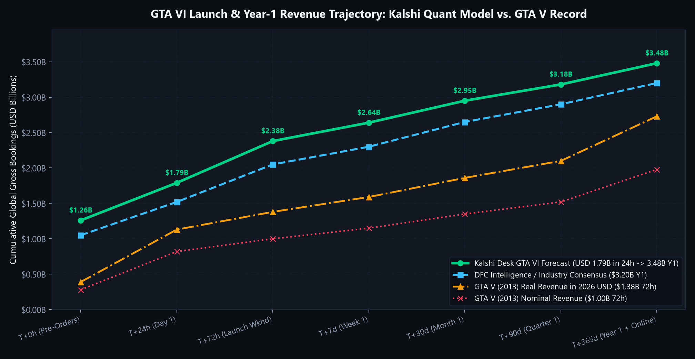
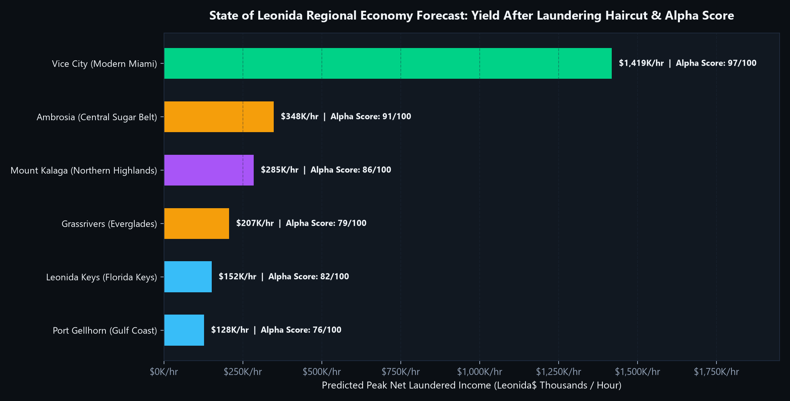
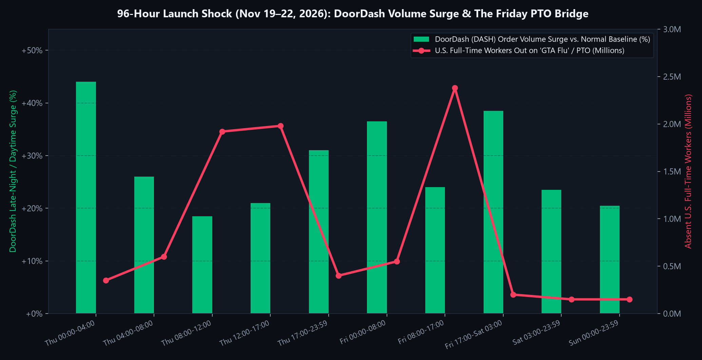
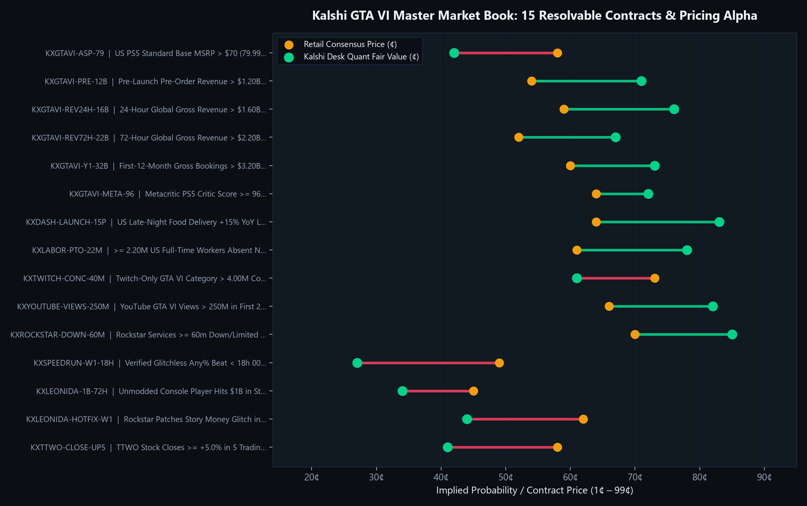

# GTA 6 PREDICTION — State of Leonida Economy, Launch Shock & Kalshi Market Book

[_Dossier-111827?style=for-the-badge)](../README.md)

> **Pre-Launch Quantitative Dossier (`T-12 Hours` to Midnight Launch, November 19, 2026)**  
> Using 13 years of verified *GTA V / GTA Online* & *RDR2* economic telemetry alongside Rockstar's confirmed Leonida disclosures (**Lucia Caminos, Jason Duval, Raul Bautista, Boobie Ike, Brian Heder**, and the six confirmed regions of Leonida), this directory contains our desk's **ex-ante falsifiable predictions, Day-1 exploit-hunting protocol, 96-hour U.S. labor & DoorDash shock curve, and 15 priced Kalshi Event Contracts**.

---

## Headline Pre-Launch Predictions (Published Before Midnight Unlock)

| Forecast Dimension | Consensus / Naive View | Kalshi GTA Desk Prediction | Primary Structural Driver |
| :--- | :--- | :--- | :--- |
| **24-Hour Global Revenue** | ~\$1.3B–\$1.5B | **\$1.79 Billion (`22.4M` units)** | 100% of accumulated digital pre-orders recognize at `T+0` sell-through (~32% Deluxe attach) |
| **72-Hour Global Revenue** | ~\$2.0B | **\$2.38 Billion (`2.38x` GTA V)** | Zero physical stockouts (~87% digital share vs. ~12% in Sept 2013) |
| **Year-1 Gross Bookings** | \$3.20B (DFC Intelligence) | **\$3.48 Billion** | High-margin *GTA VI Online* currency launch inside Year-1 window |
| **Leonida Core Money Mechanic** | *"Same LCN/BAWSAQ stock exploit as GTA V"* | **Dirty Stash Cash -> Boobie Ike Front Laundering (`10–20%` cut) -> Dual Equity/Meme-Crypto App** | Rockstar closes frictionless bullion deposits; mid-game laundering fronts become mandatory |
| **Heist Min-Max Meta** | *"Pick cheap static crew members"* | **Raul Bautista Dynamic Risk-for-Cut Splits (`75–85%` duo split at max heat)** | Mechanical execution replaces static menu optimization; 2-protagonist split boosts per-char cash **+50%** |
| **U.S. Workplace Absenteeism** | *"Same as a Tuesday game launch"* | **2.38M Absent Workers (`2.29x` GTA V); `-\$1.05B` Net Output Friction** (vs `-\$2.68B` media claim) | **Thursday Nov 19** creates a massive 4-day-weekend PTO/sick-out bridge across Friday Nov 20 |
| **DoorDash (`DASH`) Launch Surge** | *"Moderate weekend bump"* | **+\$434.2M Incremental `DASH` GOV (`+44%` midnight peak; +\$648M total US delivery)** | >85% preloaded digital copies = zero GameStop commute, 96h indoor lock-in |

---

## Visual Forecast Suite

### 1. GTA VI Revenue Trajectory vs. DFC Consensus & GTA V (2013) Record

### 2. Leonida's 6 Confirmed Regions: Net Laundered Hourly Yield & Exploit Alpha Score

### 3. 96-Hour Launch Weekend Timeline: DoorDash (`DASH`) Order Surge & U.S. Absenteeism Wave

### 4. Kalshi GTA VI Master Market Book: 15 Event Contracts & Pricing Edge

---

## Folder Contents

### Research Reports
1. [**`01_Leonida_Economy_Predictive_Blueprint.md`**](01_Leonida_Economy_Predictive_Blueprint.md) — Regional economic mapping (*Vice City, Leonida Keys, Grassrivers, Port Gellhorn, Ambrosia, Mount Kalaga*), Dirty-vs-Clean cash laundering thesis, parody crypto rug-pull curves, `INT64` circuit breakers, and our **First-6-Hours Live Stream Diagnostic Checklist**.
2. [**`02_Kalshi_GTA6_Market_Book_and_Edge_Model.md`**](02_Kalshi_GTA6_Market_Book_and_Edge_Model.md) — Full pricing book across **15 resolvable Kalshi contracts** (`KXGTAVI-ASP-79`, `KXGTAVI-REV24H-16B`, `KXDASH-LAUNCH-15P`, `KXSPEEDRUN-W1-18H`, `KXTTWO-CLOSE-UP5`, etc.) + our **Launch-Night Barbell Pair Trade**.
3. [**`03_Nov19_Real_World_Macro_and_DoorDash_Forecast.md`**](03_Nov19_Real_World_Macro_and_DoorDash_Forecast.md) — Why Thursday Nov 19 triggers a 2.29x larger absence wave than Tuesday Sept 17, 2013, hour-by-hour 96h delivery/bandwidth timeline, and equity sector winners/losers.

### Spreadsheets & Raw Datasets
- [**`spreadsheets/Kalshi_GTA6_Leonida_Prediction_Model.xlsx`**](spreadsheets/Kalshi_GTA6_Leonida_Prediction_Model.xlsx) — **5-Tab Live-Formula Excel Forecast Workbook**.
- [`data/01_leonida_regional_economy_forecast.csv`](data/01_leonida_regional_economy_forecast.csv) — Regional dirty cash, laundering haircuts, heat index & exploit alpha scores.
- [`data/02_gta6_revenue_trajectory_72h_to_y1.csv`](data/02_gta6_revenue_trajectory_72h_to_y1.csv) — `T+0` through `T+365d` revenue curve vs. DFC & GTA V.
- [`data/03_nov19_hourly_doordash_and_labor_curve.csv`](data/03_nov19_hourly_doordash_and_labor_curve.csv) — 96-hour U.S. concurrency, `DASH` surge %, and workplace absence wave.
- [`data/04_kalshi_gta6_15_contracts_pricing.csv`](data/04_kalshi_gta6_15_contracts_pricing.csv) — 15 Kalshi event contracts with retail consensus, desk fair value, and edge in bps.
