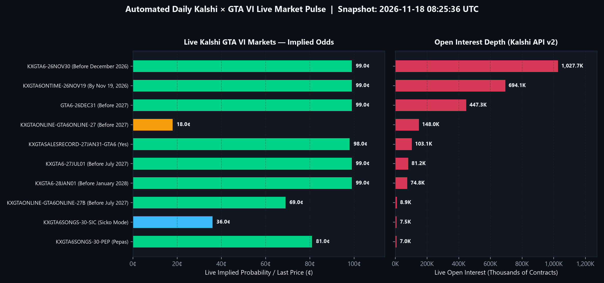

# Automated Daily GTA VI & Leonida Market Pulse — 2026-11-18
**Generated Automatically by Kalshi GTA Research Bot**  
**Timestamp:** `2026-11-18 08:25:36 UTC` | **Launch Clock:** `T-20.6h to Midnight EST Launch` | **Schedule:** Daily at `09:00 AM EST (14:00 UTC)`

---

## 1. Live Cross-Market Snapshot (Kalshi API v2 + Equities + Gaming Telemetry)

| Signal Pillar | Live Observed Metric | Latest Reading | Desk Interpretation |
| :--- | :--- | :--- | :--- |
| **Kalshi GTA VI Ecosystem** | Active Open Contracts (`8` Series) | **`62` markets** | `2,652,485` open interest / `5,246,110` cumulative contracts traded |
| **24h Revenue Record (`KXGTASALESRECORD`)** | *Highest-grossing game in 24h?* | **`98.0¢`** | Market heavily prices Day-1 pre-order + Deluxe ASP record smash |
| **Launch On-Time (`KXGTA6ONTIME`)** | *Releases by Nov 19, 2026?* | **`99.0¢`** | Locked into midnight regional console rollout |
| **Take-Two Interactive (`TTWO`)** | NASDAQ Live / Last Close | **\$203.93 (-4.47%)** | Public equity proxy for Year-1 bookings & GTA VI Online expectations |
| **DoorDash (`DASH`)** | NASDAQ Live / Last Close | **\$164.91 (-2.87%)** | Primary real-economy derivative for 96-hour launch delivery surge (`+\$434M` GOV model) |
| **GTA V Pre-Launch Baseline** | Live Steam Concurrent (`AppID 271590`) | **34,644 concurrent PC players** | Tracks franchise engagement & post-Nov-19 cannibalization velocity |
| **Speedrun.com Verification** | Verified *GTA VI* Any% Runs | **`0` verified runs** | Monitors sub-18h Week-1 speedrun threshold (`KXSPEEDRUN-W1-18H`) |

---

## 2. Live Kalshi GTA VI Orderbook Leaders (Sorted by Open Interest)

| Kalshi Ticker | Series | Market / Outcome | Last (`¢`) | Bid / Ask (`¢`) | 24h Vol | Open Interest |
| :--- | :--- | :--- | ---: | :---: | ---: | ---: |
| `KXGTA6-26NOV30` | `KXGTA6` | WIll GTA6 be released by Nov 30, 2026? [Before December... | **99.0¢** | `99¢ / 100¢` | 125,083 | **1,027,700** |
| `KXGTA6ONTIME-26NOV19` | `KXGTA6ONTIME` | Will GTA 6 be released by Nov 19, 2026? [By Nov 19, 2026] | **99.0¢** | `98¢ / 99¢` | 298,305 | **694,114** |
| `GTA6-26DEC31` | `KXGTA6` | WIll GTA6 be released by Dec 31, 2026? [Before 2027] | **99.0¢** | `99¢ / 100¢` | 10,167 | **447,296** |
| `KXGTAONLINE-GTA6ONLINE-27` | `KXGTAONLINE` | Will Rockstar Games release GTA VI Online to the public... | **18.0¢** | `16¢ / 18¢` | 76,145 | **147,951** |
| `KXGTASALESRECORD-27JAN31-GTA6` | `KXGTASALESRECORD` | Will GTA 6 break the record for the highest-grossing vi... | **98.0¢** | `98¢ / 100¢` | 23,403 | **103,087** |
| `KXGTA6-27JUL01` | `KXGTA6` | WIll GTA6 be released by Jul 1, 2027? [Before July 2027] | **99.0¢** | `99¢ / 100¢` | 4,239 | **81,176** |
| `KXGTA6-28JAN01` | `KXGTA6` | WIll GTA6 be released by Jan 1, 2028? [Before January 2... | **99.0¢** | `99¢ / 100¢` | 555 | **74,814** |
| `KXGTAONLINE-GTA6ONLINE-27B` | `KXGTAONLINE` | Will Rockstar Games release GTA VI Online to the public... | **69.0¢** | `68¢ / 69¢` | 2,957 | **8,851** |
| `KXGTA6SONGS-30-SIC` | `KXGTA6SONGS` | What songs will be on the GTA 6 radio at launch? [Sicko... | **36.0¢** | `35¢ / 40¢` | 320 | **7,534** |
| `KXGTA6SONGS-30-PEP` | `KXGTA6SONGS` | What songs will be on the GTA 6 radio at launch? [Pepas] | **81.0¢** | `79¢ / 80¢` | 304 | **6,984** |
| `KXGTA6SONGS-30-BLI` | `KXGTA6SONGS` | What songs will be on the GTA 6 radio at launch? [Blind... | **35.0¢** | `33¢ / 35¢` | 205 | **5,464** |
| `KXGTA6SONGS-30-BAD` | `KXGTA6SONGS` | What songs will be on the GTA 6 radio at launch? [Bad a... | **18.0¢** | `13¢ / 15¢` | 637 | **5,398** |

---

## 3. Live Visual Orderbook & Open-Interest Pulse

---

## 4. Historical Daily Automation Log (`daily_telemetry_log.csv`)

- **Cumulative Snapshots Logged:** `1`
- **Raw Time-Series CSV:** [`daily_telemetry_log.csv`](daily_telemetry_log.csv)
- **Full Live Kalshi Orderbook CSV:** [`live_kalshi_gta6_orderbook.csv`](live_kalshi_gta6_orderbook.csv)
