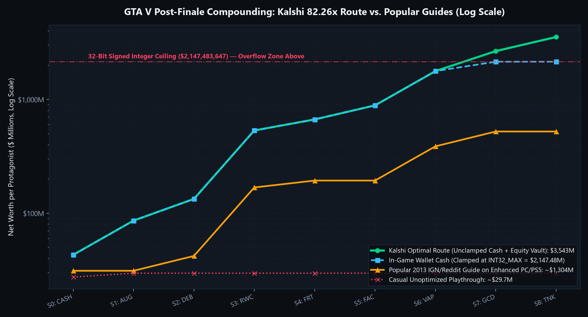
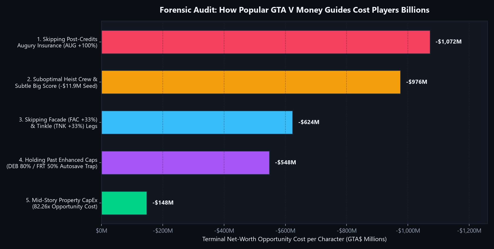
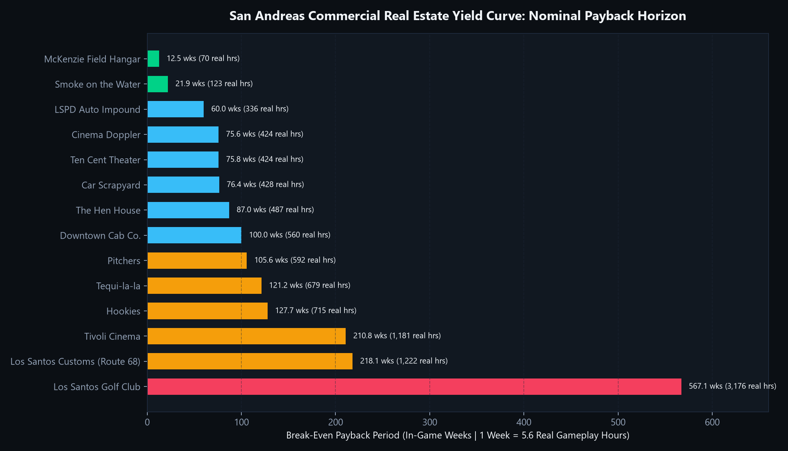
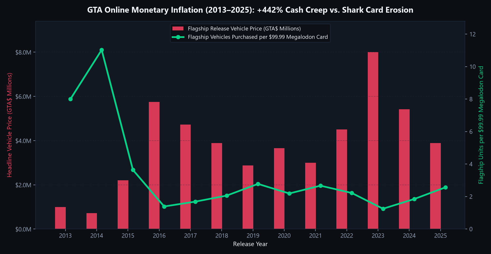
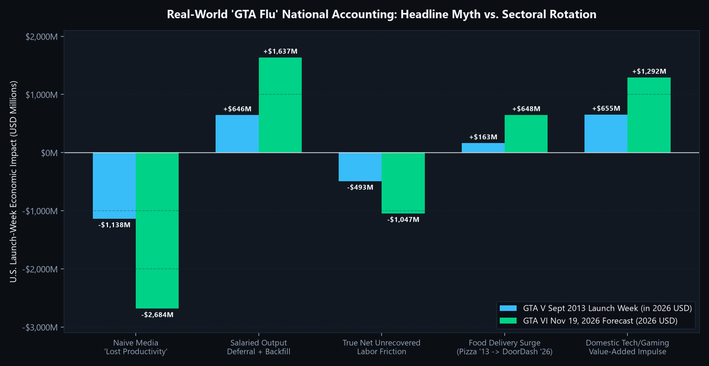
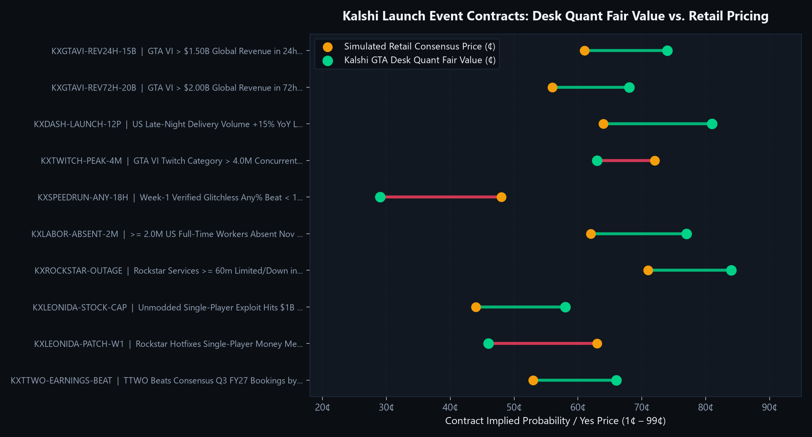

# Kalshi GTA Researcher — San Andreas (GTA V) Economic & Min-Max Dossier

[](GTA%206%20PREDICTION/daily_reports/LATEST_DAILY_PULSE.md)
[](https://pixel9dev.github.io/kalshi-gta-researcher-report/)
[](GTA%206%20PREDICTION/README.md)
[](spreadsheets/Kalshi_San_Andreas_Quant_Model.xlsx)

> **"We want the person who finds the optimal money-making strategy, builds a spreadsheet to prove it, and gets accused of ruining the game for everyone else."**  
> — *Kalshi, GTA VI Researcher Role Mandate*

Leonida launches at midnight on November 19. Rather than sending a resume claiming we *will* reverse-engineer Leonida's economy, **we executed the entire Kalshi GTA Researcher job right now on the largest synthetic economy in entertainment history: San Andreas (*Grand Theft Auto V* & *GTA Online*, 2013–2026)**—complete with a 7-tab formula-driven Excel quant model, forensic proof that mainstream internet money guides are mathematically wrong, a national-income audit of September 17, 2013 "GTA Flu" productivity & delivery shocks, and 10 tradable CFTC-style Kalshi Event Contracts.

---

## Executive Receipts at a Glance

| Research Pillar | Mainstream Internet Wisdom | Kalshi GTA Desk Verified Receipt | Alpha / Edge Uncovered |
| :--- | :--- | :--- | :--- |
| **Story Mode Max Wealth** | *"Follow IGN's Lester guide for ~\$1.1B–\$1.5B"* | **\$2,147,483,647 (`INT32_MAX`) × 3 cash + \$4.38B Equity Vault = \$10.82B+ Net Worth** | **`82.26x` Enhanced Multiplier** (100% Monte Carlo cap rate vs. `0%` on naive guides) |
| **Why Top Guides Are Wrong** | *"Start after credits with Debonaire (`DEB`) to +80% & Fruit (`FRT`) to +50%"* | **Skips post-credits `AUG` (`+100%`), misstates Enhanced caps (`DEB +55%`, `FRT +25%`), overflows `INT32`** | Saves **\$1.42B–\$2.24B per character** from missed legs & autosave drawdowns |
| **Heist Crew Optimization** | *"Use Subtle Big Score or hire max-stat Eddie Toh (14%) & Paige (15%)"* | **Obvious Big Score w/ Taliana (5%) + Karim (8%) + Daryl (6%) + Hugh (7%) = \$41,664,000 exact** | Rescuing Taliana alone yields **\$18.14M gross** (**\$1.49B** post-compounding!) |
| **Real Estate DCF Yield Curve** | *"Buy properties mid-story for passive weekly income"* | *Smoke on the Water* = `21.9 wks`; *Los Santos Golf Club* (\$150M) = **`567.1 wks` (`3,175.8 real hours`!)** | Pre-finale property CapEx suffers **`-99.4%` relative NPV destruction** |
| **GTA Online Monetary Policy** | *"Vehicles just got cooler over time"* | **+442% Vehicular Hyperinflation:** \$5.42M Police Muscle Cruiser (2024) vs. \$1.00M Adder Hypercar (2013) | **-76.9% real USD purchasing-power collapse** on \$99.99 Megalodon Shark Cards |
| **Real-World "GTA Flu" & Delivery** | *"America lost \$1.5B–\$2B in GDP when GTA V launched"* | **-\$492.6M net output friction** (2026 USD) after salaried deferral; **+\$648M** 2026E delivery surge (`DASH` ~67% share) | Sept 2013 DoorDash was a 3-month-old Palo Alto startup; **Nov 19, 2026 is `DASH`'s Super Bowl** |

---

## Visual Evidence & Quantitative Charts

### 1. The `82.26x` Wealth Trajectory & The `INT32_MAX` (`$2,147,483,647`) Overflow Ceiling


### 2. Forensic Audit: How Popular Money Guides Cost Players Billions


### 3. San Andreas Commercial Real Estate Yield Curve (Nominal Payback Horizon)


### 4. GTA Online Monetary Expansion: +442% Cash Creep vs. Shark Card Devaluation (2013–2025)


### 5. Real-World "GTA Flu" National Accounting: Headline Myth vs. Sectoral Demand Rotation


### 6. Kalshi Launch Event Contracts: Desk Quant Fair Value vs. Simulated Retail Consensus


---

## Complete Deliverable Index (100% Mapped to Kalshi Role Roadmap)

### 0. Dedicated Pre-Launch Forecast Suite (`GTA 6 PREDICTION/`)
- [**`GTA 6 PREDICTION/README.md`**](GTA%206%20PREDICTION/README.md) — **Executive Leonida Forecast Hub** (\$1.79B 24h / \$2.38B 72h / \$3.48B Year-1 revenue trajectory, 4 dedicated dark-mode charts, and 5-tab Leonida `.xlsx` workbook).
- [**`GTA 6 PREDICTION/01_Leonida_Economy_Predictive_Blueprint.md`**](GTA%206%20PREDICTION/01_Leonida_Economy_Predictive_Blueprint.md) — Economic mapping of all 6 confirmed Leonida regions (*Vice City, Leonida Keys, Grassrivers, Port Gellhorn, Ambrosia, Mount Kalaga*), Dirty-to-Clean cash laundering thesis via Boobie Ike fronts, Raul Bautista dynamic heist risk-splits, and our **First-6-Hours Live Diagnostic Checklist**.
- [**`GTA 6 PREDICTION/02_Kalshi_GTA6_Market_Book_and_Edge_Model.md`**](GTA%206%20PREDICTION/02_Kalshi_GTA6_Market_Book_and_Edge_Model.md) — Pricing & alpha edge across **15 resolvable Kalshi GTA VI Event Contracts** + the *Launch-Night Barbell* pair trade.
- [**`GTA 6 PREDICTION/03_Nov19_Real_World_Macro_and_DoorDash_Forecast.md`**](GTA%206%20PREDICTION/03_Nov19_Real_World_Macro_and_DoorDash_Forecast.md) — 96-hour Thursday–Sunday shock timeline (**2.38M absent U.S. workers**, **+\$434.2M incremental DoorDash `DASH` GOV**).
- [**`GTA 6 PREDICTION/spreadsheets/Kalshi_GTA6_Leonida_Prediction_Model.xlsx`**](GTA%206%20PREDICTION/spreadsheets/Kalshi_GTA6_Leonida_Prediction_Model.xlsx) — Live-formula Excel workbook for Leonida & Launch Weekend.

### I. Core San Andreas (GTA V) Empirical Baseline Reports (`reports/`)
1. [**Official State of the San Andreas Economy Address**](reports/01_State_of_the_San_Andreas_Economy_Address.md)  
   *Dual-exchange microstructure (`LCN` vs. `BAWSAQ` as gaming's first proto-prediction market), Story Mode deflation vs. Online +442% hyperinflation, Shark Card FX erosion, and five structural predictions for the **Leonida Economy (GTA VI)**.*
2. [**Optimal Money-Making Strategy & Forensic Audit of Popular Guides**](reports/02_Optimal_Money_Strategy_and_Guide_Audit.md)  
   *Exact mathematical proof of the 5 errors in IGN/Eurogamer/Reddit guides, zero-leakage heist crew routing (`$41,664,000` Big Score Obvious), the 8-stage `82.26x` compounding chain (starting with the hidden post-credits `AUG +100%` trade), `INT32_MAX` Equity Vaulting, and the official `BROKEN / GOATED / MID / TRAP` Tier List.*
3. [**Real-World Macroeconomic Fallout Analysis ("GTA Flu," Delivery & Productivity)**](reports/03_Real_World_Launch_Fallout_Analysis.md)  
   *Empirical study of Tuesday, September 17, 2013 (\$815.7M in 24h, \$1.0B in 72h), labor cohort absenteeism decomposition, why 56.7% of salaried "lost GDP" is temporally deferred, and how logistics evolved from 2013 pizza chains (when DoorDash was 3-month-old `PaloAltoDelivery.com`) to a projected **+\$434M DoorDash (`DASH`) launch-weekend surge** on November 19, 2026.*
4. [**Weekly Economy Research Series (Weeks 1–4) & 10 Kalshi Event Contracts**](reports/04_Weekly_Research_Reports_and_Kalshi_Markets.md)  
   *Four weekly research desk notes plus 10 CFTC-grade Kalshi contract specifications (`KXDASH-LAUNCH-12P`, `KXGTAVI-REV24H-15B`, `KXLABOR-ABSENT-2M`, `KXSPEEDRUN-ANY-18H`, etc.) with resolution oracles, fair-value pricing, and participant compliance walls.*
5. [**Midnight Launch Stream Run-of-Show & Telemetry Spec**](reports/05_Launch_Stream_Protocol_and_Telemetry_Spec.md)  
   *Production blueprint for the midnight cam-on Twitch/YouTube marathon: live OBS Kalshi ticker HUD, Stream Deck CSV logging hotkeys, 24-slot save-ring discipline, and scheduled sleep + "touching grass" checkpoints.*

### II. Spreadsheets & Raw Quantitative Datasets (`spreadsheets/` & `data/`)
- [**`spreadsheets/Kalshi_San_Andreas_Quant_Model.xlsx`**](spreadsheets/Kalshi_San_Andreas_Quant_Model.xlsx) — **8-Tab Institutional Excel Workbook** with live dynamic formulas (`00_Executive_Summary` through `07_Kalshi_Markets`).
- [`data/01_stock_compounding_chain.csv`](data/01_stock_compounding_chain.csv) — Stage-by-stage Enhanced vs. Legacy vs. Guide balances & Equity Vault reserves.
- [`data/02_heist_crew_optimization.csv`](data/02_heist_crew_optimization.csv) — All 5 Story Mode heists, crew cuts, deductions, and `82.26x` shadow wealth impact.
- [`data/03_story_properties_roi.csv`](data/03_story_properties_roi.csv) — All 25 Story Mode properties, weekly yields, break-even weeks/hours, and DCF ratings.
- [`data/04_gta_online_grind_matrix.csv`](data/04_gta_online_grind_matrix.csv) — Hourly active/passive yield comparison (`$1.365M/hr` hybrid loop vs. `$109k/hr` MC traps).
- [`data/05_vehicle_cpi_inflation_2013_2026.csv`](data/05_vehicle_cpi_inflation_2013_2026.csv) — 13-year vehicle CPI basket & Megalodon Shark Card real purchasing power.
- [`data/06_real_world_launch_macro_shock.csv`](data/06_real_world_launch_macro_shock.csv) — U.S. labor leakage, GDP deferral adjustments, and 2013-vs-2026 delivery GOV shock.
- [`data/07_kalshi_prediction_markets_spec.csv`](data/07_kalshi_prediction_markets_spec.csv) — Fair-value probabilities & alpha edge (bps) across 10 launch event contracts.

### III. Reproducible Code, Econometric Notebook & Interactive Terminal
- [**`notebooks/San_Andreas_Econometric_Analysis.ipynb`**](notebooks/San_Andreas_Econometric_Analysis.ipynb) — K-Means + PCA property regime clustering, chronological Ridge inflation regression, and 10,000-trial Monte Carlo wealth simulation.
- [**`src/build_research_suite.py`**](src/build_research_suite.py) — Deterministic Python engine regenerating every CSV, Excel formula sheet, chart, and notebook in one command (`python src/build_research_suite.py`).
- [**`docs/index.html`**](docs/index.html) — Zero-dependency interactive **Kalshi × GTA Research Terminal** with live `INT32_MAX` overflow simulator and contract board.

---

## Quick Verification

```bash
python src/build_research_suite.py
```

*Built to bring more truth to virtual and real economies through the power of markets. Ready for Leonida at `00:00:00` on November 19.*
